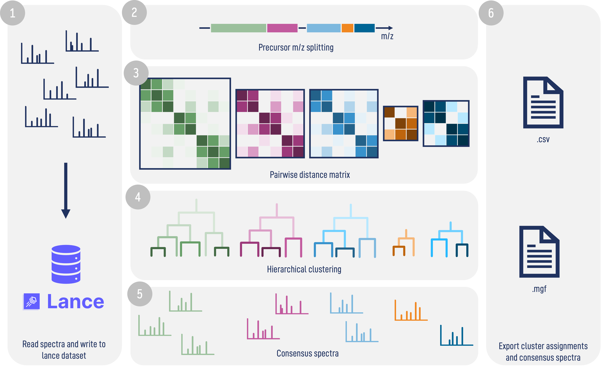

_falcon_
========


For more information:

* [Official code website](https://github.com/bittremieuxlab/falcon)

The _falcon_ spectrum clustering tool uses advanced algorithmic techniques for
highly efficient processing of millions of MS/MS spectra. Spectra are read from
peak files and stored in Lance columnar datasets, partitioned by precursor
charge. Within each charge bucket spectra are split into batches by precursor
_m_/_z_, a full pairwise cosine distance matrix
is computed in parallel using Numba-accelerated code, and hierarchical
clustering is applied to group similar spectra into clusters.

The software is available as open-source under the BSD license.

If you use _falcon_ in your work, please cite the following publication:

- Wout Bittremieux, Kris Laukens, William Stafford Noble, Pieter C. Dorrestein.
**Large-scale tandem mass spectrum clustering using fast nearest neighbor
searching.** _Rapid Communications in Mass Spectrometry_, e9153 (2021).
[doi:10.1002/rcm.9153](https://doi.org/10.1002/rcm.9153)

Installation
------------

_falcon_ requires Python 3.11+ and is available on Linux and macOS.

You can install _falcon_ with pip or uv:

```bash
pip install falcon-ms
```

For development setup, testing, and contribution guidelines, see
[CONTRIBUTING.md](https://github.com/bittremieuxlab/falcon/blob/main/CONTRIBUTING.md).

Running _falcon_
----------------

_falcon_ can be run from the command line or programmatically from Python.
Settings are configured hierarchically via built-in defaults, optional TOML configuration files (`-c`/`--config` and `extends`), and command-line flags.
_falcon_ takes peak files (in the mzML, mzXML, or MGF format) as input and exports the clustering result as a comma-separated file with each MS/MS spectrum and its cluster label on a single line.
Representative spectra for each cluster can optionally be exported to an MGF file.

Example _falcon_ run with command-line arguments:

```bash
falcon peak/*.mzml falcon --export-representatives --precursor-tol 20 ppm --fragment-tol 0.05 --distance-threshold 0.10
```

This clusters all MS/MS spectra in mzML files in the `peak` directory with the specified settings and writes (i) the cluster assignments to `falcon.csv` and (ii) the cluster representatives to `falcon.mgf`.

### Hierarchical TOML configuration

Instead of hardcoding named profiles, _falcon_ layers sparse TOML override files on top of its standard defaults:

1. **Built-in defaults** (bottom-up proteomics baseline).
2. **Explicit TOML config file(s)** passed via repeatable `-c`/`--config` flags (left-to-right; no config file is auto-loaded from the current directory).
   Any TOML file may also inherit from one or more parent files using a top-level `extends = "base.toml"` or `extends = ["base.toml", "instrument.toml"]` key (paths resolve relative to the declaring file).
3. **CLI flags** (highest precedence; omitted flags never overwrite values from TOML files, and boolean flags support `--flag`/`--no-flag`).

For example, [configs/metabolomics.toml](https://github.com/bittremieuxlab/falcon/blob/main/configs/metabolomics.toml) overrides only the fields that differ for untargeted metabolomics:

```toml
[preprocessing]
min_mz = 0.0
max_mz = 1000.0
min_mz_range = 150.0

[clustering]
min_matched_peaks = 6
```

Run with an overlay and per-run CLI overrides:

```bash
falcon peak/*.mzml results -c configs/metabolomics.toml --distance-threshold 0.15 --save-config run_resolved.toml
```

Because TOML has no `null` literal, optional fields can be explicitly disabled/reset across layers using `"none"` (for `work_dir`, `rt_tol`, `remove_precursor_tol`, and `max_peaks_used`) or `"auto"` (for `precursor_charge_buckets`).

Useful configuration inspection flags:

- `falcon -c configs/metabolomics.toml --print-config`: print the fully resolved TOML configuration and exit.
- `falcon ... --save-config resolved.toml`: save the exact resolved TOML before running (replay later via `falcon -c resolved.toml -o new_prefix`).
- `falcon --dump-schema`: output the JSON Schema for TOML editor validation and autocomplete.
- `falcon --version`: display the installed _falcon_ version.

### Programmatic Python API

```python
import falcon

cfg = falcon.load_config(
    config_files=["configs/metabolomics.toml"],
    overrides={
        "io": {
            "input_filenames": ["peak/*.mzml"],
            "output_filename": "results",
        },
        "clustering": {"distance_threshold": 0.15},
    },
)
falcon.run(cfg)
```

Important settings
------------------

Here we provide information on the most important settings that influence _falcon_ clustering performance.
All settings have sensible default values (organized into `[io]`, `[preprocessing]`, `[clustering]`, and `[consensus]` TOML tables) and are strictly type- and range-validated before execution.

For detailed information on all available CLI options, run `falcon -h` or `falcon --help`.

**Input/output (`[io]`)**

- `input_filenames` and `output_filename` (positional arguments or `-i`/`--input` and `-o`/`--output`): Input peak file path(s) or glob patterns and the output file prefix (`<prefix>.csv` and optional `<prefix>.mgf`).
  Repeatable `-i`/`--input` and `-o`/`--output` flags provide named alternatives to positional paths (useful when overriding only the output prefix from a saved TOML config); positional and named forms cannot be mixed.
- `work_dir` (`--work-dir`): Optional directory for staging per-charge Lance datasets and the `staging_cache.json` provenance manifest (or `"none"` for a temporary directory removed on exit, the default).
  Supplying an explicit directory persists staged datasets so subsequent runs with matching inputs, preprocessing, `fragment_tol`, and `precursor_charge_buckets` automatically reuse the validated cache across clustering, consensus, and output sweeps.
- `overwrite` (`--overwrite` / `--no-overwrite`): Overwrite existing `.csv`/`.mgf` outputs and rebuild any cached staging datasets in `work_dir`.
  Without `--overwrite`, existing outputs abort safely and mismatched or unverified caches fail fast; default is `false`.
- `export_representatives` (`--export-representatives` / `--no-export-representatives`): Compute and export one representative spectrum per cluster to `<prefix>.mgf`.
  Default is `false`.

**Spectrum comparison (`[clustering]`)**

- `precursor_tol` (`--precursor-tol MASS MODE`): The precursor mass tolerance (`mass >= 0`) and unit (`"ppm"` or `"Da"`).
  Default is `20 ppm`.
- `rt_tol` (`--rt-tol`): Optional retention time tolerance (`>= 0`, or `"none"` to disable) to restrict clustering to spectra with similar retention times.
  Note that retention-time units are not unified across input formats (MGF uses seconds via `RTINSECONDS`, mzXML values are converted to minutes by Pyteomics, and mzML preserves file-native units), so match `rt_tol` to your input files' units and avoid mixing incompatible units across formats.
  Default is disabled (`none`).
- `fragment_tol` (`--fragment-tol`): The fragment mass tolerance in _m_/_z_ (`> 0`) used during spectrum comparison.
  Default is `0.05`.

**Clustering (`[clustering]`)**

- `linkage` (`--linkage`): The linkage criterion for hierarchical clustering (`single`, `complete`, or `average`).
  Default is `complete`.
- `distance_threshold` (`--distance-threshold`): The cosine distance threshold in `(0, 1)` at which clusters are cut from the hierarchical tree.
  Values between `0.05` and `0.15` typically yield pure clusters; values up to `0.30` can be used for more aggressive merging.
  Default is `0.10`.
- `min_matched_peaks` (`--min-matched-peaks`): Minimum number of matched fragment peaks required to consider two spectra similar (`>= 0`, and `<= max_peaks_used` when peak capping is enabled).
  Default is `0`; typically set to `6` for metabolomics data.
- `batch_size` (`--batch-size`): Maximum number of spectra per precursor _m_/_z_ batch (`>= 1`).
  Default is `32768`.
- `precursor_charge_buckets` (`--precursor-charge-buckets`): Charge state groupings that determine which spectra can be clustered together.
  In TOML, pass a list of buckets such as `[[1], [2, 3], ["unknown"], "other"]` (or `"auto"` to cluster every observed charge separately, the default).
  On the CLI, pass one bucket per token such as `'[1]' '[2, 3]' unknown other` or `auto`.

**Consensus spectrum (`[consensus]`)**

- `method` (`--consensus-method`): Method used to compute the representative spectrum for each cluster: `medoid` (default) or `average` (intensity-averaged spectrum with iterative sigma clipping).
- `outlier_cutoff_lower` and `outlier_cutoff_upper` (`--outlier-cutoff-lower`, `--outlier-cutoff-upper`): Positive standard-deviation cutoffs below/above the median intensity used for outlier rejection.
  Valid only when `consensus.method = "average"`; default is `1.5` for both.

**Spectrum preprocessing (`[preprocessing]`)**

The default preprocessing settings target bottom-up proteomics.
For untargeted metabolomics or top-down data, layer a sparse TOML override file such as [configs/metabolomics.toml](https://github.com/bittremieuxlab/falcon/blob/main/configs/metabolomics.toml).

- `min_peaks` (`--min-peaks`) and `min_mz_range` (`--min-mz-range`): Discard spectra with fewer than `min_peaks` peaks (`>= 1`) or a smaller _m_/_z_ span than `min_mz_range` (`>= 0`, `<= max_mz - min_mz`).
  Defaults are `5` peaks and `250.0` _m_/_z_.
- `min_mz` (`--min-mz`) and `max_mz` (`--max-mz`): Minimum (`>= 0`) and maximum (`> min_mz`) peak _m_/_z_ values.
  Before filtering, Falcon aligns both bounds outward to the `fragment_tol` grid (`min_mz` downward and `max_mz` upward), so retained peaks may fall outside the configured bounds.
  Defaults are `101.0` and `1500.0` _m_/_z_.
- `remove_precursor_tol` (`--remove-precursor-tol`): Window in Da (`> 0`, or `"none"` to disable) around the precursor _m_/_z_ within which peaks are removed.
  Default is `1.5`.
- `min_intensity` (`--min-intensity`) and `max_peaks_used` (`--max-peaks-used`): Relative base-peak intensity floor in `[0, 1)` (default `0.01`) and maximum strongest peaks retained (`>= min_peaks`, or `"none"` to retain all; default `50`).
- `scaling` (`--scaling`): Scale peak intensities by `root`, `log`, `rank`, or `off` (default).
  Note that the scaling method can influence the optimal `distance_threshold`.

How does it work?
-----------------



1. Input peak files (mzML, mzXML, or MGF) are read in parallel, quality-filtered, and normalized, then staged into per-charge Lance columnar datasets in the working directory.
2. Within each charge bucket, spectra are sorted canonically by precursor _m_/_z_, retention time, and identifier, partitioned at precursor _m_/_z_ gaps exceeding `precursor_tol`, and evenly subdivided into disjoint batches of at most `batch_size` spectra.
3. For each batch, a full pairwise cosine distance matrix is computed using Numba-accelerated kernels (large batches are tiled across worker processes). Spectrum pairs with fewer than `min_matched_peaks` matched fragments are treated as maximally distant (distance = 1.0).
4. Hierarchical clustering is performed on the pairwise distance matrix using `fastcluster`, cut at `distance_threshold` under the chosen `linkage` criterion, and refined so every cluster satisfies the full `precursor_tol` span (and optional `rt_tol` span).
5. Cluster assignments are exported to a CSV file. When `--export-representatives` is enabled, one representative (medoid or intensity-averaged consensus) spectrum per cluster is computed and exported to an MGF file.

Contact
-------

For more information you can visit the
[official code website](https://github.com/bittremieuxlab/falcon) or reach out to the Bittremieux Lab.
